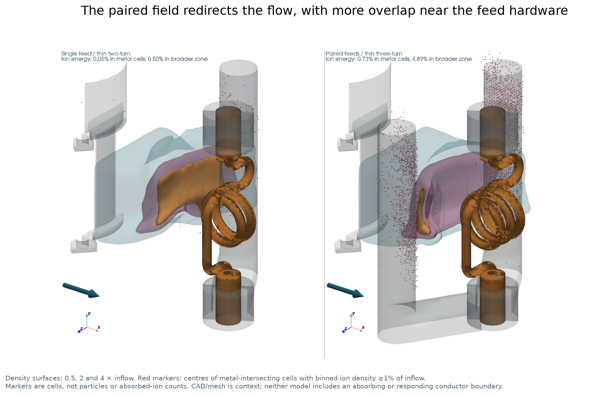

# Simjecture

[](https://pypi.org/project/simjecture/)
[](https://github.com/tomzhu0225/simjecture/actions/workflows/ci.yml)
[](https://doi.org/10.5281/zenodo.21945748)

[Try online](https://simjecture.com) · [Documentation](https://drawingsword.com/simjecture/) ·
[Research loop](https://drawingsword.com/simjecture/concepts/research-loop.html) · [Recorded studies](https://drawingsword.com/simjecture/demos/index.html) ·
[Contributing](https://github.com/tomzhu0225/simjecture/blob/main/CONTRIBUTING.md)

[中文安装、使用与开发指南](docs/zh-cn/research-group-guide.md)

**Hypothesize. Simulate. Falsify.**

Simjecture runs autonomous numerical investigations from a human-defined scientific
question. An agent designs experiments, searches for counterexamples and tests
revised hypotheses. The evidence system preserves what ran and a separate reviewer
examines whether the results justify the conclusion.

You set the question, physical scope and budget. The agent chooses how to work.
You can inspect intermediate results, steer the investigation and continue it in a
new phase. The result is a research record you can follow from hypothesis to code,
measurements, counterexamples and review.

## From hardware design to 3D plasma

The [**Qin-1 engineering study**](https://drawingsword.com/simjecture/demos/qin1-hardware-plasma.html)
connects **CAD → mesh → circuits and electromagnetics → plasma → visualization**.
An agent revised the coil and feed geometry, solved current sharing with Elmer,
transferred the checked device field into native 3D WarpX, and compared the
resulting plasma response.



The selected cold-conductor design gives **33–34% more upstream transverse field
while retaining 97.8% of the array current** across matched numerical refinements.
The plasma checks expose the limit: estimated bulk flux changes by 11–71% under
numerical controls, so quantitative shielding remains unqualified.

[**Explore the interactive results**](https://drawingsword.com/simjecture/_static/demos/qin1/viewer.html) ·
[Read the case study](https://drawingsword.com/simjecture/demos/qin1-hardware-plasma.html) ·
[Verify the retained record](demos/qin1_multiphysics/)

This is an operator-assisted local toolchain study, with explicit model limits
and failed checks preserved; it is not a formal harness-adjudicated claim or a
validated prediction of the complete experiment.

## The research loop

[](https://raw.githubusercontent.com/tomzhu0225/simjecture/main/docs/_static/architecture/research-loop.pdf)

A counterexample must survive the relevant numerical controls. Under the **repair**
completion policy, the agent then proposes the smallest justified change to the
hypothesis, commits its predictions before testing them, and collects fresh
validation evidence. Missing evidence sends the work back through the loop.

The **answer** policy can also finish with a reviewed falsification of the original
claim. New browser studies default to answer; the CLI defaults to repair. Both use
the minimal workflow: flexible agent strategy, recorded experiments and explicit
scientific acceptance. A deadline can leave the question unresolved.

Version 0.6.3 removes classical/MVP, DSH, structured and frontier launch routes.
Existing records remain readable. See the [migration guide](docs/how-to/minimal-migration.md)
for new launches and handling older runs.

New minimal studies allow experimental solver development by default. The agent can
work in a private source fork while preserving the reference installation. Changed
builds need independent, source-bound qualification before supporting a claim. Turn
this off in the study brief or with `--no-allow-solver-development`; see
[solver development and qualification](https://drawingsword.com/simjecture/how-to/minimal-oversight.html#solver-development-permission).

The optional research director can stop unaffordable experiments, request a replan
and tune remote instrument probe deadlines and retries. Operators can also delegate
storage increases for large builds and checkpoints. The monitor shows failures,
before/after limits and the reasons for changes; scientific acceptance and the
campaign deadline remain separate. See [director control and recovery](https://drawingsword.com/simjecture/how-to/minimal-oversight.html#instrument-registration-recovery).

Read [how the loop works](https://drawingsword.com/simjecture/concepts/research-loop.html) or
[how evidence is checked](https://drawingsword.com/simjecture/concepts/evidence-and-claims.html).

## Follow a real investigation

The [**48 hour FRC campaign on eight GPUs**](docs/research/frc-48-hour-campaign-20261014.md)
ended with its merger hypothesis unresolved. Its report shows the retained plasma
fields, numerical controls, model usage, API cost estimates and the controller
failures exposed by two days of research. Public tables reproduce the accounting.

[**Magnetic-island coalescence with FLASH**](https://drawingsword.com/simjecture/demos/island-coalescence.html)
shows density, magnetic geometry and a current sheet evolving in a real MHD
calculation. Follow five resistivity cases, two refinements and their evidence
map to see what was measured and why the full-range question remains open.
The classic campaign and subsequent diagnostic audits remain available.


[**FLASH → WarpX kinetic follow-up**](https://drawingsword.com/simjecture/demos/flash-warpx-patch.html)
follows an actual MHD current sheet into a kinetic particle simulation. The visual
walkthrough locates the patch, opens its pressure-measurement region, and connects
field maps and numerical controls to the unresolved scientific claim.


Both plasma investigations include preserved continuation records, downloadable
figures and explicit distinctions between a completed simulation, an approved
method and an accepted scientific conclusion.

The [orbital-accuracy walkthrough](https://drawingsword.com/simjecture/demos/kepler-energy.html) uses the current
minimal workflow to investigate a concrete question: **does small energy error
imply an accurate trajectory?** It connects the operator's brief, actual numerical
experiments, hypothesis revisions and independent review. It found five counterexamples in the original case matrix, then supported a
four-case repair using fresh simulations and independent review. The retained
record can be verified without a model call.

Earlier records remain available. In the
[historical Gray–Scott study](https://drawingsword.com/simjecture/demos/gray-scott.html), the harness rejected an
attempt to close a claim using evidence commissioned for a different claim. The
agent registered the missing contract and ran fresh experiments before closing it.
That record documents the classic workflow; it is not presented as a new-version run.

## What the evidence system preserves

| Question you should be able to ask | Recorded material |
|---|---|
| What was being tested? | Original hypothesis, operator requirements and committed repairs |
| What actually ran? | Frozen source and inputs, command, runtime identity and execution receipt |
| Where did this number come from? | Output files, hashes and the experiment cited by the claim |
| What challenged the result? | Counterexamples, controls, failed attempts and review gaps |
| Why did the investigation finish? | Independent review, completion policy and budget or stop reason |

A repaired claim cannot reuse old exploratory results as fresh validation. Changed
committed source, missing committed cases and altered recorded outputs are checked
by the service. Numerical adequacy and scientific interpretation remain review
judgments. See [the evidence guide](https://drawingsword.com/simjecture/concepts/evidence-and-claims.html).

## Try it

Open **[simjecture.com](https://simjecture.com)** for the hosted workspace with
supplied inference and compute within usage limits. Signed-in visitors can upload
files and retain projects. Guest conversations and artifacts are temporary.

For your own Linux or WSL machine, install the latest stable release:

```bash
curl -fsSL https://github.com/tomzhu0225/simjecture/releases/latest/download/install.sh | bash
```

The installer verifies the release bundle and prepares Python and the browser
workspace. Reopen it with `~/simjecture/start-workspace`. Research files live under
`~/simjecture/artifacts/projects`. See [installation options](https://drawingsword.com/simjecture/getting-started/installation.html).

In the local workspace, open **Knowledge → Connect folder** to make research files
searchable across new conversations. The library also indexes completed workspace
discussions and study reports, with versioned source citations. Indexing needs no
embedding service. See [the knowledge library guide](docs/getting-started/research-workspace.md#local-knowledge-library).

1. Choose a compatible API model or an authenticated native agent in the workspace.
2. Discuss your question and prepare a study brief with **Autonomous research**.
3. Review its hypothesis, evidence requirements, completion policy and budget.
4. Start the investigation and follow its experiments and **Evidence & review**.

The [first-study tutorial](https://drawingsword.com/simjecture/getting-started/first-run.html) walks through the full
counterexample-and-repair workflow. [Headless studies](https://drawingsword.com/simjecture/how-to/headless-studies.html)
cover terminal launches and automation.

For longer-running work, optional [projects and workspaces](docs/how-to/projects-and-workspaces.md)
group conversations and shared context, or keep separate local lab environments.
The default remains a single personal workspace. CLI and HTTP interfaces expose
the same project operations for external agents and scripts.

## Bring your instruments and compute

Ordinary Python studies work without an external solver. Optional capabilities
include WarpX, operator-supplied FLASH, EOS/opacity tools, ITER diagnostics and
[GPU cylinder flow](https://drawingsword.com/simjecture/how-to/cylinder-flow.html). The cylinder solver and its
validation records were contributed by [Zifei Meng](https://github.com/ZifeiMengSPH).

An experimental [Windows application interface](docs/how-to/windows-applications.md)
shares job execution, input snapshots and artifact collection across product adapters.
It supports [CST magnetostatic jobs](docs/how-to/cst-windows.md), native CST Python
scripts, and an initial SOLIDWORKS part rebuild/export adapter. These use trusted
Windows processes and record exploratory jobs; SOLIDWORKS still needs native
model commissioning.

- [Commission a scientific instrument](https://drawingsword.com/simjecture/how-to/guided-commissioning.html) or
  [add your own capability](https://drawingsword.com/simjecture/how-to/add-a-capability.html).
- [Run experiments on local or SSH workers](https://drawingsword.com/simjecture/how-to/ssh-workers.html).
- [Steer or continue an investigation](https://drawingsword.com/simjecture/how-to/continuation-steering.html).
- [Compare agents on recorded diagnostic tasks](https://drawingsword.com/simjecture/how-to/llm-bench.html).
- [Operate a hosted service](https://drawingsword.com/simjecture/how-to/public-trials.html).

Native agents retain their existing tools and run with their host-account access.
Numerical experiments use the selected execution backend, Bubblewrap by default.
Read [security guidance](https://github.com/tomzhu0225/simjecture/blob/main/SECURITY.md) and
[restricted-host setup](https://drawingsword.com/simjecture/how-to/restricted-containers.html) when deploying workers.

## Contribute

Help us test the research process on meaningful questions. Contributions can add
scientific instruments, validated diagnostics, reproducible studies, numerical
review, documentation or infrastructure. Start with [CONTRIBUTING.md](https://github.com/tomzhu0225/simjecture/blob/main/CONTRIBUTING.md)
or [open an issue](https://github.com/tomzhu0225/simjecture/issues) to discuss a study
or a substantial change.

[Release notes](https://github.com/tomzhu0225/simjecture/blob/main/CHANGELOG.md) · [Release checks](https://drawingsword.com/simjecture/archive/index.html) ·
[Research status](https://drawingsword.com/simjecture/research/status.html) · [Historical records](https://drawingsword.com/simjecture/archive/index.html)

## Citation and license

Use [CITATION.cff](https://github.com/tomzhu0225/simjecture/blob/main/CITATION.cff) and identify the exact version and Git commit used
for a result. The [concept DOI](https://doi.org/10.5281/zenodo.21945748) identifies
the release series.

Copyright 2026 Bowen Zhu and contributors. Licensed under [Apache 2.0](https://github.com/tomzhu0225/simjecture/blob/main/LICENSE).
See [third-party notices](https://github.com/tomzhu0225/simjecture/blob/main/THIRD_PARTY_NOTICES.md) for upstream attribution and
redistribution requirements.
