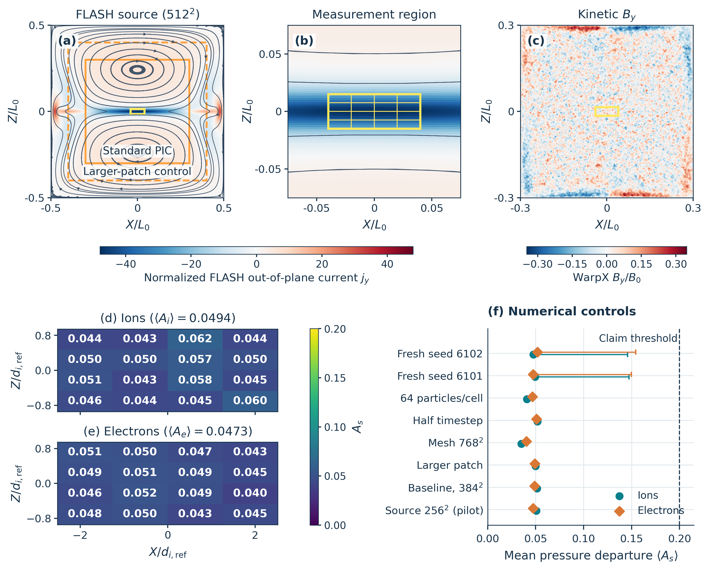

# From a FLASH current sheet to kinetic pressure measurements

**The fresh Simjecture 0.7.0 investigation supports the local pressure-isotropy
prediction within its tested scope.** Independent claim and report reviews both
accepted the retained evidence. Two fresh particle realizations remain below the
0.20 threshold after adding the declared numerical and sampling allowances.



The source and measurement panels locate the actual kinetic problem. The magnetic
field and pressure maps use fresh seed 6101. The control panel includes both
fresh seeds; rightward bars add the declared sensitivity allowances. They are
empirical diagnostic envelopes, not statistical confidence intervals.
[Download figure PDF](../_static/demos/fresh-v070-coupled-fields.pdf).

## What connects the two solvers

The worker selects a current sheet from a fresh $512^2$ FLASH trajectory at
$t/\tau_A=0.8001$, then transfers its density, scalar pressure, bulk flow, magnetic
field and current into WarpX. A discrete-curl reconstruction preserves a
solenoidal magnetic field; species drifts reproduce current and center-of-mass
flow. The measured sheet half-width is $1.0114d_i$, spanning 8.22 FLASH cells.

This is a one-way initialization of a collisionless local kinetic problem.
FLASH's scalar resistivity is not continued in PIC, and kinetic fields do not
feed back into FLASH. The declared physical mapping uses $m_i/m_e=25$ and initial
$T_i/T_e=1$; it does not infer a unique physical plasma from normalized MHD.

The worker freezes the source selection, mapping, measurement and decision rule
before collecting claim evidence. Local species mean flow is subtracted from
particle velocities before constructing the pressure tensor. The observable is

$$
A_s=\frac{\|P_s-\operatorname{tr}(P_s)I/3\|_F}
{\sqrt{3}\operatorname{tr}(P_s)/3},
$$

averaged over a fixed $4\times4$ interior grid and
$t\Omega_{ci,\mathrm{ref}}\in[0.4,0.9]$. Missing or underpopulated bins invalidate
the measurement rather than being discarded.

## What the tests found

| Species | Seed 6101 | Seed 6102 | Maximum mean + allowance | Threshold |
|---|---:|---:|---:|---:|
| Ions | 0.04939 | 0.04779 | 0.14747 | 0.20 |
| Electrons | 0.04733 | 0.05205 | 0.15448 | 0.20 |

The controls test source refinement, a $384^2\to768^2$ kinetic mesh change, a
halved timestep, 32 versus 64 particles per cell, a larger patch at matched
cell size, finer measurement bins and independent particle seeds. The additive
allowance also retains sampling, flow-shear and relativistic-pressure corrections.
The independent reviewer reproduced the fresh means from native tensors and
checked control outputs and identities before accepting the finite prediction.

The Debye scale remains underresolved, electric-field noise changes with numerical
settings, and boundary-flux quadrature is approximate. The pressure controls and
allowances support this threshold decision; they do not establish continuum
convergence or a generally valid isotropic MHD closure.

## Execution and independent review

The numerical study used **Simjecture 0.7.0, commit
`cfca558cb30868d7bc12af7a9b636303f7bc500b`**. GPT-6.1 Sol at high effort served as
worker, director and reviewer in separate contexts. It retained **25 successful
execution receipts and three failed receipts**, including a fresh FLASH source
and two prospective evidence-stage kinetic runs.

The initial two-hour allowance ended before claim review completed. Report review
also exposed a response-format mismatch: an accepted response included nonblocking
comments in a field reserved for blocking issues. The operator subsequently
authorized 30 minutes for review only. A case-owned controller used unchanged
v0.7.0 review transport and validators, preserved the original numerical deadline
and records, and completed both reviews in **469 seconds**. No new simulations
were run in that session. The scientific verdict came from the independent
reviewer, with the controller and authorization retained in the audit.

## Inspect and reproduce

- [Fresh compact audit and omitted-data identities](../../demos/flash_warpx_kinetic_patch/fresh_v070_record/manifest.json)
- [Original hypothesis](../../demos/flash_warpx_kinetic_patch/fresh_v070_record/operator_input/hypothesis.txt)
- [Independent claim verdict](../../demos/flash_warpx_kinetic_patch/fresh_v070_record/reviews/review_01645441bd0eaebf3e6391fd.json)
- {download}`Scientific report and full uncertainty ledger <../../demos/flash_warpx_kinetic_patch/fresh_v070_record/research/RESULTS.md>`
- [Post-run report assessment and session identity](../../demos/flash_warpx_kinetic_patch/fresh_v070_record/post_run_review.json)
- [Review-only controller](../../demos/flash_warpx_kinetic_patch/fresh_v070_record/post_run_session/complete_review.py)
- [Frozen figure provenance](../../demos/flash_warpx_kinetic_patch/fresh_v070_visual_data/coupled_study_provenance.json)

From the repository root:

```bash
uv run python scripts/verify_research_audit.py demos/flash_warpx_kinetic_patch/fresh_v070_record
uv run --extra flash-demo python scripts/render_fresh_plasma_examples.py
```

The public audit preserves original receipts, review packets, sources and compact
outputs. Large solver states are explicitly omitted; integrity verification and
figure regeneration do not replace full numerical replay. Fresh investigations
need qualified FLASH and WarpX capabilities and a configured agent backend.
FLASH source and binaries remain operator-supplied.

The [historical two-hour study and its continuation](flash-warpx-patch-historical.md)
remain available with their unresolved outcomes. Those records are unchanged.
