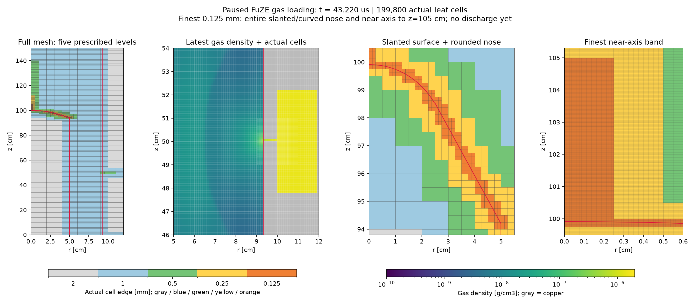
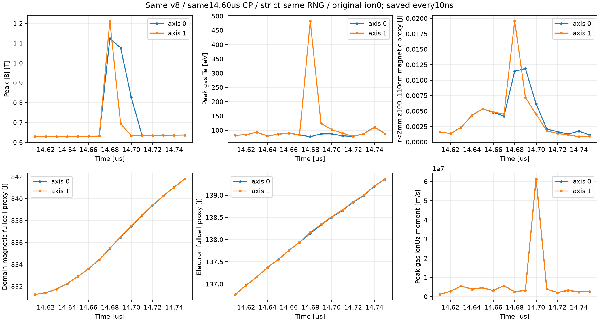

# FuZE mesh refinement and solver diagnostics

**Where should a limited cell budget go, and how can we tell whether a solver
change improves a plasma calculation?** LCB119's local experiments explored
these questions with FLASH gas loading and native WarpX development.

The FLASH branch placed **199,800 cells in five prescribed refinement levels**
and advanced gas loading to **43.22 µs**. The WarpX branch established a short
RNG-aware restart comparison, then used the same starting stochastic state to
test an axis-boundary candidate. That candidate still produced near-axis
transients and was not adopted as a repair.

**Record type:** operator-assisted exploratory host development, using the
installed Simjecture 0.7.0 workspace. This retrospective snapshot was exported
on 4 November 2026. It has no formal harness-adjudicated scientific verdict.
The FLASH and WarpX results below belong to separate branches, not a coupled run.

[Inspect the retained record](https://github.com/tomzhu0225/simjecture/tree/main/demos/fuze_mesh_solver_diagnostics)

## Place refinement where geometry needs it



[Open the full-size mesh and density figure](../_static/demos/fuze/flash-paused.png).

The final V5 layout preserves the cylindrical domain, $r=0$–12 cm and
$z=0$–150 cm. The finest band follows the full slanted/rounded inner-electrode
surface and the near-axis region through $z=105$ cm. Deeper electrode interiors
can remain coarse. The gas-port audit reports a discrete width of 1 mm.

| Observed level | Cell edge | Leaf blocks | Leaf cells |
|---|---:|---:|---:|
| 1 | 2 mm | 163 | 16,300 |
| 2 | 1 mm | 1,075 | 107,500 |
| 3 | 0.5 mm | 218 | 21,800 |
| 4 | 0.25 mm | 214 | 21,400 |
| 5 | 0.125 mm | 328 | 32,800 |
| Total | | 1,998 | **199,800** |

The archive checkpoint is at **43.2197013177 µs**, with finite positive density,
electron/ion temperatures and internal energies, and maximum species-sum error
about $3.0\times10^{-10}$. The solver stopped normally and automatic continuation
was disabled. The requested loading target was 178 µs; it was not reached.

An earlier same-executable continuation probe redistributed the checkpoint from
8 to 20 MPI ranks and advanced three steps, from 24.762623 to 24.775763 µs.
Its recorded thermodynamic checks passed. This is a bounded restart check,
not proof that every rank layout or later physical stage is equivalent.

This is **prescribed spatial refinement on PARAMESH**, not demonstrated dynamic
tracking of moving plasma gradients. The picture's full-device and electrode
panels show block boundaries; the density and near-axis panels include actual
cell lines. The last forced plot can precede the final checkpoint by one step.
Gas loading alone does not qualify nonzero-field transport across coarse/fine
interfaces, a discharge, first pinch or secondary breakdown. No such result or
mesh-convergence claim is made here.

## Make a restarted control comparable

The WarpX work uses a **modified native RZ CUDA/PETSc build**, with base source
revision `9a685ce598192acde30a0f99f963867ba6441f42`, local Hall/QDSMC development
and checkpoint hooks. It is separate from the packaged WarpX 26.07 PICMI
capability. Executable identities are retained for the v7 RNG candidate and
v8 composition with the axis-boundary candidate.

The test asks whether a continuous trajectory and a split trajectory reproduce
the same outputs when the split run restores a saved random state. Both use
the original physical/numerical settings, including a 0.5 ns timestep.

| Control | Recorded outcome |
|---|---|
| RNG feature disabled | Two original/v2 13-field regressions pass the recorded 1e-10 criterion |
| Strict restore from a legacy checkpoint without a snapshot | Rejected before any physical step |
| Continuous 14.55–14.65 µs versus split at 14.60 µs | Five resumed frames, 13 fields each; maximum relative L2 **1.67869e-12** |
| Final RNG sidecars | Identical recorded SHA-256 and byte-comparison result |
| Newly injected feed cohort | 400 particles; all seven compared attributes exactly equal |
| Deliberately corrupted copied snapshot | Rejected before any physical step; original checkpoint preserved |

The copied common 14.60 µs anchor is excluded from the five resumed-frame
comparison. This avoids counting a copied frame as an independently evolved
restart result.

The local candidate saves host RNG and the CUDA state used by `ParallelForRNG`.
It excludes a private bulk GPU generator, is not a generic portable RNG format,
and cannot reconstruct stochastic history missing from a legacy checkpoint.
These checks establish short-window continuity for this build and path;
they do not establish long-time convergence or a general WarpX restart defect.

## Keep a failed repair visible



[Open the full-size axis-control figure](../_static/demos/fuze/same-rng-axis.png).

After four two-step composition regressions, the v8 comparison starts both
axis-off and axis-on cases from the same generated **14.60 µs checkpoint**,
with the same verified RNG restore before step 29201. Only
`hybrid_pic_model.qdsmc_axis_regular_velocity` changes. Both complete to
14.75 µs, saving 15 frames each at 10 ns cadence; all 13 saved fields are finite.

The candidate imposes the intended derived-velocity axis regularity, but this
does not resolve the observed transient:

| Window diagnostic | Axis off | Axis on |
|---|---:|---:|
| Peak saved magnetic magnitude | 1.12375 T | 1.21179 T |
| Peak saved gas electron temperature | 110.63 eV | 482.86 eV |
| Final retained initial-ion count | 1,377,978 | 1,377,979 |

At 14.68 µs the axis-on local magnetic-energy proxy is larger, even though its
final local proxy is smaller. A final-frame comparison would hide that spike.
Final RNG sidecars match, and the 1,200 newly injected feed particles have
exactly matching compared attributes. Different fields nevertheless change
particle trajectories and retention: the one-ion difference is recorded,
not coerced into identical mass.

**Decision: do not adopt the axis-boundary candidate as a repair or resume
production on that basis.** Both cases also exhibit large deposited `ionUz`
moments; these are not individual-particle maximum velocities. No spatial,
particle-number or time convergence, nor experimental fidelity, is established.

The conductivity gate in this branch is externally prescribed. It is not
self-consistent neutral ionization. Embedded electrodes do not constitute a
resolved copper heating/ablation model. Full-cell magnetic/electron energy
proxies omit an exact cut-cell, circuit, particle and boundary-flux ledger;
they are not a full conservation proof.

## Reuse the diagnostic methods

The reusable contributions live in the existing skills:

- FLASH: inspect actual leaf boxes and cell sizes; distinguish prescribed mesh
  placement from feature tracking; qualify checkpoint redistribution and active
  version-specific source paths.
- WarpX: freeze operator-stage inputs, inspect axis/ghost regularity at the
  stage actually consumed, and control restart/RNG continuity before interpreting
  a stochastic on/off comparison.

Experiment-specific mesh placements, thresholds and failed candidates stay in
this record. They are not defaults for future scientific studies.

## Verify and interpret the public excerpt

```bash
python3 demos/fuze_mesh_solver_diagnostics/verify_record.py
```

This standard-library command verifies seven retained files and recalculates
mesh accounting and recorded comparison arithmetic. It needs no solver,
licensed source, GPU or API key. The
[demo README](https://github.com/tomzhu0225/simjecture/tree/main/demos/fuze_mesh_solver_diagnostics)
describes the export command, original source hashes and omissions.

Raw fields, particles, checkpoints, local source overlays and solver binaries
are not distributed. Consequently the checkout cannot independently recompute
the field norms, reproduce the solver runs or validate the physics from raw data.
The public excerpt is an inspectable development record, not a turnkey physical
reproduction. The exact application Git commit was not retained.

LCB119 provided the scientific framing, operational choices and steering.
Agents performed local development, simulations and working-assistant audits;
the excerpt and walkthrough are later editorial work. Independent formal
scientific acceptance is not claimed.
