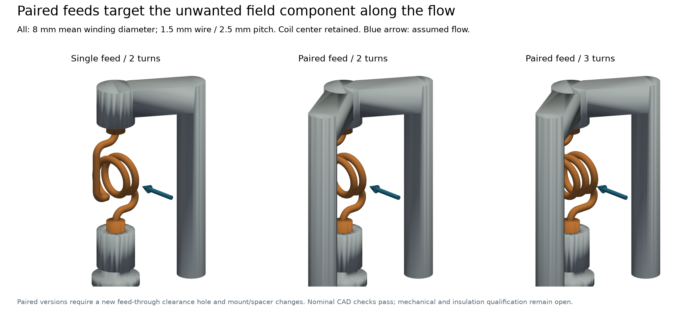
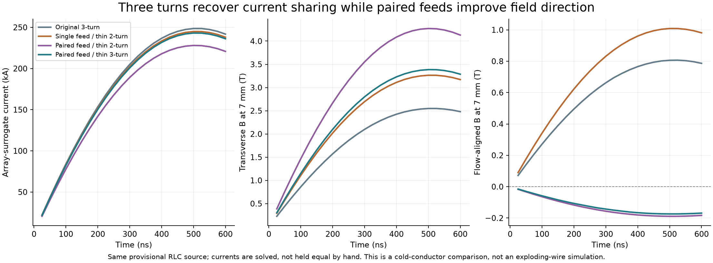
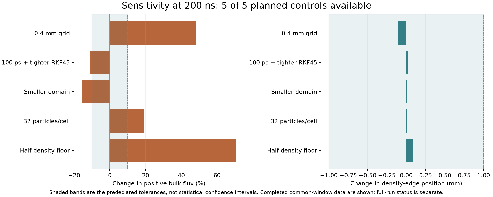

# From hardware design to circuits, fields and 3D plasma

**Can we improve the magnetic obstacle in a wire-array experiment without
starving the array of current—and follow the resulting field into a plasma
calculation?** The Qin-1 study connected geometry design, meshing, circuit/EM
simulation, field transfer and kinetic-ion plasma dynamics on a local machine.

The selected cold-conductor design produces **33–34% more upstream transverse
field while retaining about 97.8% of the original array current** across matched
mesh/time comparisons. Native 3D WarpX calculations show compression and
deflection under a prescribed aluminium inflow. Their numerical controls also
show why a quantitative shielding prediction is premature.

**Record type:** operator-assisted host execution, 23–24 October 2026, using
Simjecture tools and skills, custom scripts and an operator-supplied native
WarpX build. This is an exploratory toolchain demonstration, without formal
harness adjudication or an independently accepted scientific verdict.

```{raw} html
<p><a href="../_static/demos/qin1/viewer.html"><strong>Open the interactive results viewer</strong></a></p>
```

[Inspect the numerical record](https://github.com/tomzhu0225/simjecture/tree/main/demos/qin1_multiphysics)

## Follow the engineering chain

| Stage | What actually ran | What connected it to the next stage |
|---|---|---|
| Geometry | Gmsh's OpenCASCADE kernel changed windings, feed paths, mounts and clearance | STEP geometry, dimensions, contact and interference checks |
| Mesh | Gmsh generated conductor/air tetrahedra | Material/port groups, positive elements and conductor connectivity |
| Electromagnetics and circuit | Elmer solved the retained 3D conductors coupled to a finite-capacitor RLC source | Current division, circuit/FEM checks and spatial fields |
| Field transfer | Python sampled the FEM field and constructed a divergence-compatible vector potential | Explicit SI units/frame, source hashes and native WarpX import checks |
| Plasma | Native 3D CUDA WarpX hybrid PIC advanced collisional Al ions with fluid electrons | Common-time fields, particle moments and numerical controls |
| Analysis | Python, PyVista/VTK and Matplotlib | CAD/field overlays, 3D density surfaces, plots and the interactive viewer |

FreeCAD is available as a general Simjecture CAD tool, but these geometry edits
used Gmsh/OpenCASCADE. FLASH was assessed for a future wire-source calculation;
it did not evolve plasma in this study. The executed connection is **one-way
static-field coupling**, with no plasma feedback into the circuit.

## A feed redesign, with the solved current sharing retained



The search extended the winding comparison and then changed the feed arrangement.
The selected concept has three turns, 8 mm mean diameter, 1.5 mm copper conductor
and 2.5 mm pitch. A second feed/mount and a return-plate clearance hole are required;
it is a fixture change. An earlier two-turn, 2 mm-conductor option preserves the
original mounts and remains the simpler alternative.

A reflected feed was not accepted merely because it looked symmetric: geometry
intersections had to be resolved, and the revised current division had to be
solved again. Nearby feed/return currents affect both impedance and field direction.
[Download geometry figure](../_static/demos/qin1/paired_feed_geometry.pdf).



| Nominal cold-conductor result | Original three-turn device | Selected paired-feed device |
|---|---:|---:|
| Maximum sampled transverse field at the upstream 7 mm probe | 2.548 T | 3.386 T |
| Maximum sampled array-branch current | 248.6 kA | 243.1 kA |
| Array-current retention | 100% | 97.8% |
| Mean frontal magnetic-pressure proxy, radius-3 mm disk at 500 ns | 2.43 MPa | 4.09 MPa |

Matched calculations at 0.8/0.6 mm mesh targets and 25/12.5 ns timesteps retain
the relative field benefit. Two levels constrain this comparison; they do not
establish complete asymptotic convergence. The highest-field paired two-turn
alternative retains only 91.7% of array current and misses the chosen 95%
engineering target. That target is a study choice, not a universal design rule.
[Download circuit/field figure](../_static/demos/qin1/paired_feed_fields.pdf).

The source uses the operator-selected published Qin-1 condition, ±40 kV,
370 kA short-circuit peak and 275 ns 10–90% rise time.
[Qin-1 source paper](https://doi.org/10.7498/aps.75.20260383).
The effective 80 kV, 1.89 µF, 0.0644 Ω and 51.03 nH RLC model remains a
provisional fit; the fixture is not de-embedded. The array is a fixed copper-shell
surrogate. Neither real wire ablation nor coil survival is established by these
cold-conductor results.

## Follow the field into an actual 3D plasma calculation


The imported field contains the entire retained coil, array and feed/return
network at the 500 ns FEM state. It is held constant on a **separate plasma-test
clock**. The assumed beam has electron density $1.25\times10^{22}$ m⁻³, speed
100 km/s, fixed Al charge state 3.5, injected ion temperature 20 eV and isothermal
electrons at 15 eV. Ion collisions and fixed resistivity are included.

At 200 ns the paired-feed field places the estimated density edge **1.34 mm
farther upstream than the thin two-turn reference**, or 1.76 mm relative to the
original device. This edge is a falling density-profile crossing, not a verified
magnetopause or bow shock. The front is still moving.

The same calculation exposes a hardware-boundary limitation: about 4.89% of ion
kinetic energy lies in cells in the unqualified near-metal region, mostly near
the feed assembly. The red markers identify occupied cells intersecting modeled
metal, not individual impacts or absorbed particles. CAD in these views supplies
spatial context; WarpX did not contain absorbing/responding conductor boundaries.
[Download 3D comparison](../_static/demos/qin1/plasma_hardware_overlap.pdf).

The paired case's mean density on the fixed readout plane is 1.29% of inflow,
below its 2% numerical density floor. Its tiny flux and plane velocities are
unqualified leakage metrics. The viewer marks that flux and hides the velocity.
No radial wire-plume source, ablation, radiation, evolving ionization or
plasma-to-circuit feedback is included. The paired geometry also needs its own
numerical qualification; checks on the reference do not transfer automatically.

## The numerical checks change what we can claim



| Reference control at the common 200 ns snapshot | Positive bulk-flux change | Density-edge shift |
|---|---:|---:|
| 0.4 mm grid | +48.1% | −0.105 mm |
| 100 ps timestep with tighter magnetic solver tolerance | −11.1% | +0.023 mm |
| Smaller domain | −15.8% | +0.008 mm |
| Doubled nominal particle count | +19.1% | +0.005 mm |
| Halved density floor | +70.8% | +0.084 mm |

**Zero of five meet the 10% flux tolerance; five of five meet the 1 mm edge
tolerance.** A stable edge does not establish converged leakage. The flux is an
integral of positive cell-mean bulk flow through a fixed central plane, not a
velocity-resolved one-way particle flux or global shielding efficiency.
[Download sensitivity figure](../_static/demos/qin1/plasma_sensitivity.pdf).

The density-edge observable was added after inspecting a preliminary 140 ns
state, before the sensitivity outcomes. The common 200 ns comparison was fixed
before reading the original-device 200 ns result and queued control outcomes.
The [dated plan](../../demos/qin1_multiphysics/record/comparison-plan.json) preserves
those decisions. The finer grid also uses a slightly padded box; these are
numerical-sensitivity comparisons, not isolated truncation-error estimates.

Seven of nine production runs reached 220 ns. A 90-minute limit stopped the
original-device run; the host shutdown interrupted the fine-grid run. Both retain
finite 200 ns outputs, with their incomplete requested durations still recorded.
Recovery verified that the old processes were absent before starting untouched
queued cases. Completed windows, execution success and numerical adequacy remain
separate facts.

## What is reusable

The general tools support user-authored geometry, mesh and Elmer models; the coil
is an example, not a required schema. This study adds practical lessons for
choosing model boundaries, checking a field on the receiving solver's grid,
preserving diagnostics across an interrupted campaign and exposing failed checks
in the final visualization. See [CAD and simulation tools](../how-to/cad-and-simulation.md).

The skill updates cover those techniques without copying the study's dimensions,
plasma assumptions or tolerances into defaults. A future measured wire-source
model could use FLASH and thermodynamic/transport data, followed by a longer
time-dependent interaction calculation. Those are next steps, not results of
this record.

## Inspect the record without rerunning the simulations

```bash
python demos/qin1_multiphysics/verify_record.py
```

This standard-library check verifies retained bytes, recomputes the design ratios
and five sensitivity comparisons, and matches the viewer readouts to the record.
It makes no model calls and launches no solver. The [record guide](https://github.com/tomzhu0225/simjecture/tree/main/demos/qin1_multiphysics)
identifies what is included and omitted. Large raw outputs, CAD, installed backends
and private host paths remain outside this public excerpt; hashes identify those
sources but cannot validate unavailable data.

The user supplied the experimental aim, selected source condition and overnight
authorization. Early headless coil-field screening and verification ideas were
contributed by [`@motismoore-ctrl`](https://github.com/motismoore-ctrl)
([PR #37](https://github.com/tomzhu0225/simjecture/pull/37)), motivating the full
3D CAD, coupled Elmer/circuit and plasma toolchain used here. The assistant
performed the design/search, numerical work and reporting. The retained checks
are not a separate independent scientific review.
Software identities are frozen in [study metadata](../../demos/qin1_multiphysics/record/study.json):
Elmer 26.2.1 with an isolated solver-core patch and native WarpX
26.09-150-g30962d771c58. This study does not change the supported dimensions or
features of the packaged WarpX 26.07 PICMI capability.
