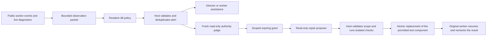

# Simjecture monitoring coprocessor experiments

This research package connects a four-billion-parameter decision model to real
Codex workers and WarpX experiments. The model observes public tool activity and
live diagnostic files, then chooses whether to keep observing, request worker
assistance, wake the director, or request an independent harness-repair judge.
The model cannot grant permissions or accept scientific claims.

The package depends on a Simjecture checkout containing the helper workflow from
[PR 45](https://github.com/tomzhu0225/simjecture/pull/45). It is an experimental
integration, with its own evaluation driver; it does not enable monitoring or
self-modification in ordinary production studies.

See the [overnight results and limitations](../../research/evaluations/monitor-coprocessor-20261023/RESULTS.md)
for the real-worker comparison, sampled-return update and fresh base/adapter
evaluation. The experiments establish a working integration, not an advantage
over simple rules or an improvement from RL.

## Flow and authority



The monitor sees completed public tool events and incremental simulation logs;
private reasoning events are excluded. Packets retain evidence identities and
hashes. Token-aware packing records which older events the model omitted, and
training checks the exact rendered prompt hash against the behavior record.

The host handles explicit help requests, completion, cancellation and hard
budgets. Monitor alerts are identified as inferred observations. A separate
judge may grant a particular repair within the operator's fixed policy. Both the
judge and repair proposer run through the existing read-only native transport.
The host checks allowed paths, original file hashes, grant expiry and fixed
verification before applying a single atomic file replacement. Candidate code is
tested under Bubblewrap without network access or access to host user files.
Rollback refuses to overwrite subsequent edits.

The current repair target is an isolated process-status adapter, not the
installed Simjecture supervisor. Main research workers retain the existing
cooperative same-account execution model. This prototype is not a complete
security boundary around those workers or a production hot-patching service.
A fully independent watchdog and durable observer recovery remain necessary for
recovering from a frozen or crashed orchestration process.

## Local checks

Use the repository environment for native workers and a separate environment for
model dependencies:

```bash
uv sync --frozen --extra workspace --group docs
uv pip install --python .venv/bin/python -e packages/simjecture-monitor
.venv/bin/pytest packages/simjecture-monitor/tests -q
.venv/bin/ruff check packages/simjecture-monitor
```

The tests include actual sandbox enforcement, invalid and expired grants,
rollback, live diagnostic observation before EOF, missing model coverage,
behavior-probability logging and parent continuation after a repair supersedes a
provisional report. Linux with Bubblewrap is required for the repair tests.

## Model serving

The initial policy is `internlm/Intern-Decision-4B`, pinned to
`38c9dafbbef52dd04bae943c0c6ac918419adfd5`. It retains the checkpoint's system
prompt, chat template, masked decision position and calibration temperature.
Monitoring instructions are supplied separately. Its option probabilities are
not calibrated incident probabilities for scientific work.

The tested model environment uses PyTorch 2.11.0 with CUDA 13.0,
Transformers 5.20.1, PEFT 0.21.2 and huggingface-hub 1.33.0. After installing this
package and its model dependencies in that environment:

```bash
python -m simjecture_monitor.server \
  --checkpoint /path/to/pinned/checkpoint \
  --socket /tmp/monitor.sock --status /path/to/server-status.json \
  --wall-seconds 3600 --idle-seconds 900
```

The Unix socket is private to its owner. The process loads the model once,
records latency and memory, and stops at its idle or wall limit. Model errors
remain errors; the comparison does not silently attribute rule decisions to the
learned policy. Colab development can forward this socket through its authorized
CLI SSH connection. Runtime allocation and release are managed separately.

## Real worker trials

`scripts/live_trials.py` launches real native Codex sessions and uses the merged
helper service. It includes nominal plasma controls, an existing Langmuir
charge-residual discrepancy, an injected worker-analysis regression, and an
injected private harness defect. All solver runs execute the retained WarpX
binary. A separate verifier recomputes the original field and charge metrics
from saved plots.

```bash
.venv/bin/python packages/simjecture-monitor/scripts/live_trials.py \
  --root /path/to/new-study --case harness --policy model \
  --socket /tmp/monitor.sock
```

The initial scripts reference this machine's retained solver artifacts and
scientific Python environment. Read their path constants before replaying on a
different machine. Existing studies are not overwritten. The comparison driver
supports a `STOP` file for orderly cancellation and records source hashes.

## Learning from actual returns

The [prospective learning protocol](../../research/evaluations/monitor-coprocessor-20261023/rl_protocol.json)
defines the behavior policy, eligibility, utility and update. Sampled episodes
retain the chosen action's probability and the unchanged policy's greedy shadow
choice. Rewards come from actual worker continuations, independently checked
reports, capable-agent starts and elapsed time. There is no scripted action-to-
reward table. Missing monitor coverage is preserved and excluded from the
on-policy training set; native agent failures remain outcomes.

```bash
.venv/bin/python packages/simjecture-monitor/scripts/collect_sampled.py \
  --root /path/to/new-collection --socket /tmp/monitor.sock
.venv/bin/python packages/simjecture-monitor/scripts/export_returns.py \
  --root /path/to/new-collection --output /path/to/returns.json
python packages/simjecture-monitor/scripts/train_returns.py \
  --base /path/to/pinned/checkpoint --data /path/to/returns.json \
  --output /path/to/new-training-output
```

The learner validates prompt identity and initial behavior probabilities,
updates only LoRA parameters with a clipped categorical policy-gradient loss,
and checks gradients and saved-adapter reload. The tiny exploratory cohorts do
not establish RL superiority or justify deployment from a score increase alone.

## Follow-up reward design

The [literature review and frozen-data audit](../../research/evaluations/monitor-reward-20261024/REVIEW.md)
identify case identifiers in actual model inputs and sensitivity to the binary
feedback condition. The original learning dataset and learner remain unchanged.
New runs through `collect_sampled.py` and `evaluate_adapter.py` use opaque trial
directories with mappings retained in host manifests. The legacy `batch.py`
layout is retained for historical replay; use a new blinded collector for the
prospective study.

`simjecture_monitor.reward` provides a separate prospective scorer for measured
intervention-versus-waiting continuations. It checks checkpoint, observation,
worker, criteria and budget identities, keeps utility components inspectable,
and withholds the scalar when paired outcomes or measurements are missing.
It does not infer counterfactual worker behavior or authenticate receipt files.
The [paired checkpoint pilot](../../research/evaluations/monitor-paired-20261024/PROTOCOL.md)
adds verified public-context/artifact forks, opaque runtime roots, incident and
feedback ledgers and shared leases over every native role. It compares specified
interventions with waiting under the same downstream policy. These fixed actions
are not on-policy samples. `analyze_paired.py` checks receipt/context bindings
and separates the operational contract score from strict reward eligibility.
Unacknowledged helper results whose necessity was never declared leave strict
feedback measurement unknown; they are not silently counted as zero misses.

The separate [parked-worker protocol](../../research/evaluations/monitor-parked-20261024/PROTOCOL.md)
tests live monitoring while actual WarpX jobs complete and the main worker has
yielded. The private completion-adapter fixture exposes raw receipts to rules
and the unchanged 4B model, with the same deterministic fallback in all arms.
It does not clone hidden provider state or patch the installed supervisor.

`state_policy.py` provides a public-state rules comparator that recognizes
successful recovery of the same operation. `accounting.py` reports the latest
native cumulative counter per thread, preserving uncovered later interruptions
and unidentified calls. Neither agent starts nor thread counters are a billing
estimate. See the study protocols before starting native jobs; the live runners
require this machine's solver setup, explicit process budgets and owned cleanup.

```bash
.venv/bin/python packages/simjecture-monitor/scripts/audit_reward_data.py \
  --root artifacts/overnight-20261023 \
  --data artifacts/overnight-20261023/returns.json \
  --output /tmp/monitor-reward-audit.json
```
