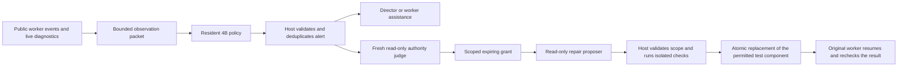

# Simjecture monitoring coprocessor experiments

This research package connects a four-billion-parameter decision model to real
Codex workers and WarpX experiments. The model observes public tool activity and
live diagnostic files, then chooses whether to keep observing, request worker
assistance, wake the director, or request an independent harness-repair judge.
The model cannot grant permissions or accept scientific claims.

The package depends on a Simjecture checkout containing the helper workflow from
[PR 45](https://github.com/tomzhu0225/simjecture/pull/45). It is an experimental
integration, with its own evaluation driver; it does not enable monitoring or
self-modification in ordinary production studies.

See the [overnight results and limitations](../../research/evaluations/monitor-coprocessor-20261023/RESULTS.md)
for the real-worker comparison, sampled-return update and fresh base/adapter
evaluation. The experiments establish a working integration, not an advantage
over simple rules or an improvement from RL.

## Flow and authority



The monitor sees completed public tool events and incremental simulation logs;
private reasoning events are excluded. Packets retain evidence identities and
hashes. Token-aware packing records which older events the model omitted, and
training checks the exact rendered prompt hash against the behavior record.

The host handles explicit help requests, completion, cancellation and hard
budgets. Monitor alerts are identified as inferred observations. A separate
judge may grant a particular repair within the operator's fixed policy. Both the
judge and repair proposer run through the existing read-only native transport.
The host checks allowed paths, original file hashes, grant expiry and fixed
verification before applying a single atomic file replacement. Candidate code is
tested under Bubblewrap without network access or access to host user files.
Rollback refuses to overwrite subsequent edits.

The current repair target is an isolated process-status adapter, not the
installed Simjecture supervisor. Main research workers retain the existing
cooperative same-account execution model. This prototype is not a complete
security boundary around those workers or a production hot-patching service.
A fully independent watchdog and durable observer recovery remain necessary for
recovering from a frozen or crashed orchestration process.

## Local checks

Use the repository environment for native workers and a separate environment for
model dependencies:

```bash
uv sync --frozen --extra workspace --group docs
uv pip install --python .venv/bin/python -e packages/simjecture-monitor
.venv/bin/pytest packages/simjecture-monitor/tests -q
.venv/bin/ruff check packages/simjecture-monitor
```

The tests include actual sandbox enforcement, invalid and expired grants,
rollback, live diagnostic observation before EOF, missing model coverage,
behavior-probability logging and parent continuation after a repair supersedes a
provisional report. Linux with Bubblewrap is required for the repair tests.

## Model serving

The initial policy is `internlm/Intern-Decision-4B`, pinned to
`38c9dafbbef52dd04bae943c0c6ac918419adfd5`. It retains the checkpoint's system
prompt, chat template, masked decision position and calibration temperature.
Monitoring instructions are supplied separately. Its option probabilities are
not calibrated incident probabilities for scientific work.

The tested model environment uses PyTorch 2.11.0 with CUDA 13.0,
Transformers 5.20.1, PEFT 0.21.2 and huggingface-hub 1.33.0. After installing this
package and its model dependencies in that environment:

```bash
python -m simjecture_monitor.server \
  --checkpoint /path/to/pinned/checkpoint \
  --socket /tmp/monitor.sock --status /path/to/server-status.json \
  --wall-seconds 3600 --idle-seconds 900
```

The Unix socket is private to its owner. The process loads the model once,
records latency and memory, and stops at its idle or wall limit. Model errors
remain errors; the comparison does not silently attribute rule decisions to the
learned policy. Colab development can forward this socket through its authorized
CLI SSH connection. Runtime allocation and release are managed separately.

For an inference link whose SSH process is supervised and reconnected separately,
`python -m simjecture_monitor.attention_transport` can keep a private local listener
available across a short interruption. Supply `--socket`, `--upstream`, `--log`
and the lease's Unix timestamp in `--stop-by`. It waits at most 20 seconds inside
the caller's 25-second timeout and permits one identical replay if a reply is
lost. Application errors are returned without replay. Logs contain timing,
attempt counts and a request digest with authentication removed.
Repeat `--upstream` to supply an already-connected standby link to the **same
frozen model runtime**. A failed connection is followed by the next link before
waiting for another handshake. Qualify both links against the same checkpoint
and input probes before using them in an experiment.

This adapter is only for the stateless prediction/health service. It must not
front commands that execute tools or dispatch assistance. Sampling requests keep
their original seed. The caller retains all freshness, identity, admission and
actual-dispatch checks; a delayed prediction can still be rejected as stale.

## Real worker trials

`scripts/live_trials.py` launches real native Codex sessions and uses the merged
helper service. It includes nominal plasma controls, an existing Langmuir
charge-residual discrepancy, an injected worker-analysis regression, and an
injected private harness defect. All solver runs execute the retained WarpX
binary. A separate verifier recomputes the original field and charge metrics
from saved plots.

```bash
.venv/bin/python packages/simjecture-monitor/scripts/live_trials.py \
  --root /path/to/new-study --case harness --policy model \
  --socket /tmp/monitor.sock
```

The initial scripts reference this machine's retained solver artifacts and
scientific Python environment. Read their path constants before replaying on a
different machine. Existing studies are not overwritten. The comparison driver
supports a `STOP` file for orderly cancellation and records source hashes.

## Learning from actual returns

The [prospective learning protocol](../../research/evaluations/monitor-coprocessor-20261023/rl_protocol.json)
defines the behavior policy, eligibility, utility and update. Sampled episodes
retain the chosen action's probability and the unchanged policy's greedy shadow
choice. Rewards come from actual worker continuations, independently checked
reports, capable-agent starts and elapsed time. There is no scripted action-to-
reward table. Missing monitor coverage is preserved and excluded from the
on-policy training set; native agent failures remain outcomes.

```bash
.venv/bin/python packages/simjecture-monitor/scripts/collect_sampled.py \
  --root /path/to/new-collection --socket /tmp/monitor.sock
.venv/bin/python packages/simjecture-monitor/scripts/export_returns.py \
  --root /path/to/new-collection --output /path/to/returns.json
python packages/simjecture-monitor/scripts/train_returns.py \
  --base /path/to/pinned/checkpoint --data /path/to/returns.json \
  --output /path/to/new-training-output
```

The learner validates prompt identity and initial behavior probabilities,
updates only LoRA parameters with a clipped categorical policy-gradient loss,
and checks gradients and saved-adapter reload. The tiny exploratory cohorts do
not establish RL superiority or justify deployment from a score increase alone.

## Measured wait controls for the five-field policy

The newer `train_decisions.py` supports supervised training and a masked
five-field policy-gradient update. Its default return baseline is the mean of
the other sampled actions for the same public state. The optional
`--advantage-baseline measured-wait` instead compares every sampled action with
the same mean of at least two independently executed no-intervention controls:

```text
advantage(sample) = measured utility(sample) − mean(measured utility(wait controls))
```

All sampled interventions can therefore have negative measured advantage, even
when one is better than the other interventions. This changes the finite-sample
baseline, not the definition of scientific success, and does not by itself
establish a better optimizer or a useful intervention. Wait branches retain
normal worker-requested help and repair requests. They are never inserted into
the optimizer as if the model sampled their forced initial action.

First create fresh training-only public checkpoints with
`scientific_counterfactual_trials.py prefix`. Record their opaque directory
names in a design such as `{"split":"train","assignments":[{"id":"cp-opaque"}]}`.
Prepare model inputs on the remote coordinator; sample on the remote A100:

```bash
python packages/simjecture-monitor/scripts/prepare_checkpoint_requests.py \
  --prefixes /study/prefixes --design /study/prefix-design.json \
  --output /study/inputs.jsonl
python packages/simjecture-monitor/scripts/sample_checkpoint_decisions.py \
  --base /models/pinned-base --adapter /models/behavior-adapter \
  --data /study/inputs.jsonl --output /study/samples \
  --temperature 3 --draws 4 --seed 2026103000
```

The preparer checks frozen artifact/transcript identities and attaches
`return_group` and `host_checkpoint_id` host metadata. These fields and the
design's case labels are excluded from the rendered model input. Transfer the
small input/proposal records between the coordinator and A100 as needed; model
weights need not pass through the local host. Keep evaluation checkpoints out
of this development dataset. Back on the coordinator, plan before executing
any proposal:

```bash
python packages/simjecture-monitor/scripts/collect_controlled_returns.py plan \
  --samples /study/samples --prefixes /study/prefixes \
  --root /study/controlled-returns --repetitions 2 --seed 2026103001
python packages/simjecture-monitor/scripts/collect_controlled_returns.py run \
  --root /study/controlled-returns --budget /study/native-budget.json \
  --backend /study/plasma-backend.json --wrapper /study/native-codex \
  --python /remote/science-env/bin/python --plasma-assets /study/plasma
```

`PLAN.json` freezes every sampled/control assignment, checkpoint identity,
proposal, collector source and randomized order. Each state forms a complete
block; collection starts a block only when its worst-case starts/time fit the
existing lease. The controller never reallocates compute or raises that lease.
It retains failed and unstarted assignments separately. A failed or incomplete
cohort is not silently reduced to a favorable training subset. Previously
attempted campaigns refuse automatic restart.

The portable `receipts` directory contains sampled outcomes, explicit wait
outcomes, `train.jsonl`, and the per-state advantage audit. The trainer verifies
receipt hashes, the common public state, criteria, worker/downstream settings,
time budget, actual sampled-answer binding, and recomputed utility. Unconfirmed
solver transport cannot supply a reward. On the remote A100 only:

```bash
python packages/simjecture-monitor/scripts/train_decisions.py \
  --base /models/pinned-base --initial-adapter /models/behavior-adapter \
  --data /study/receipts/train.jsonl --output /study/new-update \
  --mode policy-gradient --advantage-baseline measured-wait \
  --temperature 3 --maximum-tokens 8192 --kernel-profile fla-prefill \
  --steps 8 --accumulation 4 --learning-rate 1e-5
```

Use the actual sampling temperature and behavior checkpoint; the trainer
reproduces their logged probabilities before optimizing and allows at most two
passes over the sampled rows. The example update requires at least 16 samples.
Do not infer a workflow win from the training advantages. Use a separate,
prospectively frozen workflow comparison and report uncertainty, infrastructure
failures, scientific quality, time, agent usage and episode-level false alerts.
Two wait repeats are a minimum instrumentation check, not a power calculation.
This collector is public-context replay into fresh native sessions, not a copy
of private provider state or an uninterrupted streaming evaluation.
The current continuation runner starts the main worker immediately in both
branches. Its wait control means no automatic assistance to that awake worker;
it does not preserve the parked worker's wait for job completion or the normal
fallback timer. Training early wakeups requires trajectories from the deployed
parked-worker lifecycle, with that lifecycle shared by the control. Changing the
return baseline alone does not remove this operating-mode difference.

## Returns from the deployed parked-worker loop

`collect_workflow_returns.py` uses the same asynchronous scientific workflow as
the live comparison. A worker submits its real computation and yields; the
monitor samples categorical proposals only while that worker is parked and no
assistance is already active. Host admission and ordinary completion/fallback
wakeups remain responsible for resumption. The control runs that same lifecycle
with no automatic attention and retains explicit worker-requested help.

This addresses a different question from the public-checkpoint collector above:
whether attention improves a full deployed workflow. Fresh native episodes
share task configuration, criteria and budgets; they do not share an identical
private worker prefix. At least two sampled and two wait episodes per training
configuration are required. A one-pair commissioning mode checks integration,
marks its rows `commissioning`, and refuses optimizer eligibility.

On the remote A100, serve the frozen behavior adapter at the declared sampling
temperature with `python -m simjecture_monitor.attention_server` (or the named
adapter server), adding `--temperature 3`. On the coordinator, for example:

```bash
python packages/simjecture-monitor/scripts/collect_workflow_returns.py plan \
  --root /study/parked-returns --purpose train --replicates 2 \
  --family progressing_work --family update_cycle --family source_binding \
  --configuration-seed 202611010000 --order-seed 2026110101 \
  --model-policy adapted --adapter-sha256 ADAPTER_WEIGHTS_SHA256 --temperature 3 \
  --backend /study/plasma-backend.json
python packages/simjecture-monitor/scripts/collect_workflow_returns.py run \
  --root /study/parked-returns --budget /study/native-budget.json \
  --backend /study/plasma-backend.json --wrapper /study/native-codex \
  --python /remote/science-env/bin/python --plasma-assets /study/plasma \
  --socket /private/attention.sock --auth-token-file /private/attention.token
```

The plan freezes assignments, code fingerprints, actor configuration, controls,
sampling seeds, temperature and adapter weight identity before collection.
Each sampled request and response is bound to its actual observation, input
prompt, distribution and admission receipt. Missing responses, recorded provider
errors, unknown solver transport or inconsistent artifacts prevent reward
export. Failed scientific work with confirmed execution remains an outcome.
The exporter keeps episodes with no decision opportunity in the cohort while
creating no fictitious policy sample for them.

All decisions from an episode receive its measured return minus the mean of
that configuration's separate wait episodes. Polls are correlated decisions,
not additional scientific trials. Return is verified whole-workflow quality
minus the declared costs of actual native starts, whole-workflow elapsed time,
required feedback misses and duplicate dispatches. Invalid proposals and model
inference work are reported separately; host-suppressed invalid proposals receive
no invented fixed utility penalty. The coefficients are research proxies, not
provider billing prices.

Only a complete eligible training cohort produces `receipts/train.jsonl`.
The portable manifest retains every assigned episode and every sampled decision;
the trainer rejects selected subsets. On the remote A100:

```bash
python packages/simjecture-monitor/scripts/train_decisions.py \
  --base /models/pinned-base --initial-adapter /models/behavior-adapter \
  --data /study/receipts/train.jsonl --output /study/parked-update \
  --mode policy-gradient --advantage-baseline workflow-wait --temperature 3 \
  --maximum-tokens 8192 --kernel-profile fla-prefill \
  --steps 8 --accumulation 4 --learning-rate 1e-5
```

The initial adapter must reproduce the logged behavior probabilities. The update
rescales its row-averaged loss by decisions / sampled episodes, retaining
zero-opportunity episodes in that denominator. This is an episodic clipped
policy-gradient surrogate; its rows are not independent
contextual-bandit outcomes. Controls reduce sampling noise but do not eliminate
native-worker variation. New held-out workflow evaluation and general-decision
retention checks are still needed before claiming a benefit from training.

The [parked workflow commissioning](../../research/evaluations/parked-return-training-20261026/RESULTS.md)
records nine real parked-state decisions and two verified workflows, with no
automatic dispatches or optimizer updates. It validates collection after an
offline timing-schema export repair, and documents why the observed return
difference cannot establish intervention value.

The optional [constrained decoding profile](specs/scientific-attention-0.2-draft/DECODING.md)
jointly samples a route and a compatible visible question. Set
`--decision-distribution scientific-route-question/v1` in both serving and the
workflow plan. Its behavior receipts, replay and differentiable RL loss use the
same normalized distribution. The default independent profile and general-task
inputs remain unchanged. This removes impossible output combinations; it does
not guarantee fewer false alerts or more useful interventions.

## Follow-up reward design

The [draft scientific attention interface](specs/scientific-attention-0.1-draft/README.md)
specifies reusable observations, exact token-budgeted model views, five attention
actions and separate host admission. It includes JSON schemas, synthetic examples,
conformance tests and actual tokenizer measurements. Its quiet-window, freshness,
persistence and incident rules are reference mechanisms; a reduced empirical
false-alert rate has not yet been established. It is not connected to production
dispatch or the frozen study runners.

The separate [0.2 support and training-data draft](specs/scientific-attention-0.2-draft/README.md)
adds scoped knowledge lookup/literature review requests and retrieval history.
Its reproducible 16,000-example synthetic curriculum teaches scripted procedural
preferences; it contains no measured intervention utility or RL outcomes. LoRA
can train on large datasets, but no new adapter has been trained on this contract.

The [prospective training cycle](../../research/evaluations/scientific-attention-training-20261025/PROTOCOL.md)
adds a shared masked-decision compiler, supervised LoRA training, a measured-return
policy-gradient path, and scientific/general-decision evaluation scripts. Its
initial A100 smoke update verified nonzero gradients and exact adapter reload;
scientific workflow advantage and a releasable checkpoint remain under evaluation.
The earlier statements refer to their frozen studies and interface releases.

The [25 October broader comparison](../../research/evaluations/monitor-generalization-20261025/RESULTS.md)
freezes generic rules and the 4B model before new diagnostic mechanisms, includes
healthy ambiguous streams, and measures real worker outcomes. It preserves
collector-censored returns, a separate completion follow-up, and identical-input
base/LoRA replay. The learned monitor's incremental workflow value remains
unproven. Read that study's protocol and resource records before collecting more
data; do not reopen its closed native lease.

The [literature review and frozen-data audit](../../research/evaluations/monitor-reward-20261024/REVIEW.md)
identify case identifiers in actual model inputs and sensitivity to the binary
feedback condition. The original learning dataset and learner remain unchanged.
New runs through `collect_sampled.py` and `evaluate_adapter.py` use opaque trial
directories with mappings retained in host manifests. The legacy `batch.py`
layout is retained for historical replay; use a new blinded collector for the
prospective study.

`simjecture_monitor.reward` provides a separate prospective scorer for measured
intervention-versus-waiting continuations. It checks checkpoint, observation,
worker, criteria and budget identities, keeps utility components inspectable,
and withholds the scalar when paired outcomes or measurements are missing.
It does not infer counterfactual worker behavior or authenticate receipt files.
The [paired checkpoint pilot](../../research/evaluations/monitor-paired-20261024/PROTOCOL.md)
adds verified public-context/artifact forks, opaque runtime roots, incident and
feedback ledgers and shared leases over every native role. It compares specified
interventions with waiting under the same downstream policy. These fixed actions
are not on-policy samples. `analyze_paired.py` checks receipt/context bindings
and separates the operational contract score from strict reward eligibility.
Unacknowledged helper results whose necessity was never declared leave strict
feedback measurement unknown; they are not silently counted as zero misses.

The separate [parked-worker protocol](../../research/evaluations/monitor-parked-20261024/PROTOCOL.md)
tests live monitoring while actual WarpX jobs complete and the main worker has
yielded. The private completion-adapter fixture exposes raw receipts to rules
and the unchanged 4B model, with the same deterministic fallback in all arms.
It does not clone hidden provider state or patch the installed supervisor.

`state_policy.py` provides a public-state rules comparator that recognizes
successful recovery of the same operation. `accounting.py` reports the latest
native cumulative counter per thread, preserving uncovered later interruptions
and unidentified calls. Neither agent starts nor thread counters are a billing
estimate. See the study protocols before starting native jobs; the live runners
require this machine's solver setup, explicit process budgets and owned cleanup.

```bash
.venv/bin/python packages/simjecture-monitor/scripts/audit_reward_data.py \
  --root artifacts/overnight-20261023 \
  --data artifacts/overnight-20261023/returns.json \
  --output /tmp/monitor-reward-audit.json
```

Optional CUDA inference profile: in an isolated environment with the pinned model
extra, install `flash-linear-attention==0.6.0`, `fla-core==0.6.0` and
`einops==0.8.2`, then pass `--kernel-profile fla-prefill` to the model server or
local benchmark. This uses FLA's Triton gated-delta kernels and a dense prefill
convolution adapter, retaining the reference rounding before SiLU. It avoids a
locally compiled causal-conv1d extension. The default environment is unchanged.
The profile supports this monitor's single-pass `use_cache=False` classification;
packed sequences and cached generation are outside its validated scope. Runtime
identity includes the profile, FLA version and adapter-source hash. Collect new
behavior probabilities on the runtime used for policy training; floating-point
probability changes are not LoRA improvements. See the prospective protocol in
`research/evaluations/monitor-kernels-20261024/PROTOCOL.md`.
