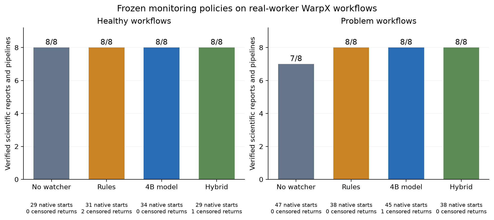
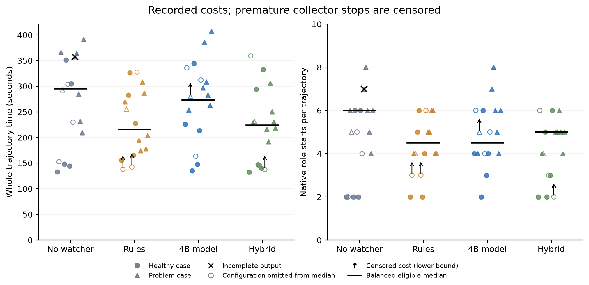
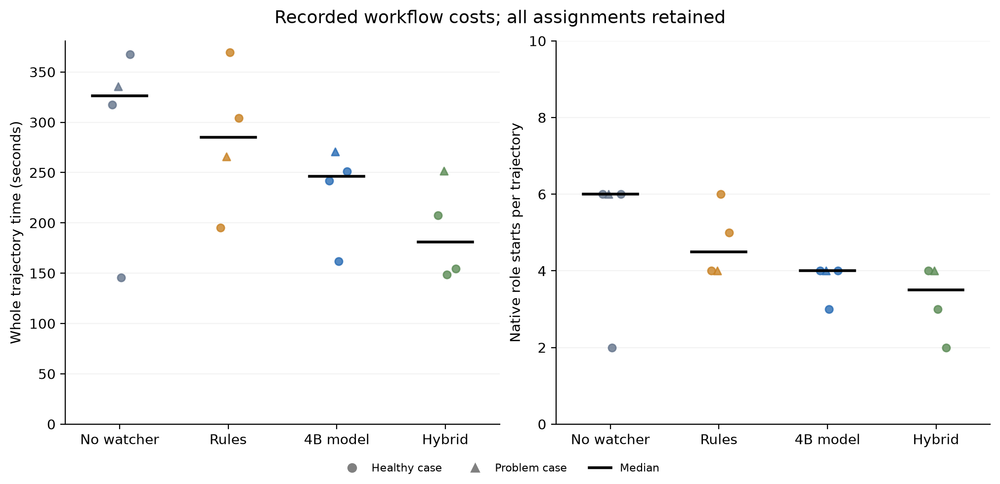

# Broader coprocessor comparison on real WarpX workflows

The broader test still does not establish an advantage for the learned
coprocessor. Generic rules requested useful early assistance on three persistent
problem mechanisms. The unchanged 4B model stayed silent on all four problem
families and requested attention during an expected publication retry instead.
Neither policy requested attention for the unit-conversion discrepancy while the
worker was parked.
The existing LoRA adapter chose exactly the same actions as the base model on all
48 identical replay inputs.

The separate completion follow-up had lower observed costs for the model and
hybrid on its four selected configurations, and revealed a healthy quiet-window
transition that triggered the frozen rule. Those narrower results are reported
separately below; they do not establish broad superiority for either approach.

This addresses a real weakness in the earlier comparison: its rule recognized
the particular stopped-process contradiction that the fixture supplied. Here the
generic operational rules were frozen before the new fixture implementation,
healthy ambiguous streams were included, and the collector supplied raw public
observations without a host fault label. The mechanisms are still authored by
the same researcher, with two repetitions per family. This is a stronger local
test, not proof that rules cover arbitrary scientific edge cases.

## What ran

The primary cohort contains 64 fresh native-worker trajectories: eight families,
four monitoring policies and two repetitions. Every trajectory actually ran the
64-cell/40-step and 128-cell/80-step WarpX controls, for 128 physical executions.
Native workers, directors, helpers and repair judges used the configured
`gpt-6-astra` high profile. The local coprocessor was the pinned
`internlm/Intern-Decision-4B`, with the previously validated FLA inference profile.
No policy threshold, prompt, base weight or adapter was trained against these
outcomes. [Protocol](PROTOCOL.md), [model identity](model-identity.json),
[policy freeze](pre-main-policy-freeze.json).

All arms could request help explicitly, receive process completion and use the
same 90-second fallback. The monitor observed public events at five-second
intervals while the main worker was parked, with one discretionary alert per
trajectory. It did not inspect private reasoning or independently supervise a
dead controller. Diagnostic publication and aggregation delays were controlled
parts of the workflow. The repetition seed changes minimum aggregation pacing
from 44 to 46 seconds; it does not seed WarpX or reproduce private provider state.

The rules cover nonzero process exits, three failed tool attempts after the retry
allowance, 30 seconds without output outside a declared quiet window, at least
four repeated observations spanning 18 seconds, and published request/source
identity disagreements. A pre-existing failed-scientific-check route was restored
before any primary outcome; the original operational-only comparator is also
retained in replay. Neither comparator branches on the evaluation family name.

## Primary outcomes and completion censoring

| Policy | Independently verified scientific outputs | Premature workflow stops | Recorded native starts | Accepted monitor alerts |
|---|---:|---:|---:|---:|
| No proactive watcher | 15/16 | 0 | 76 | 0 |
| Generic rules | 16/16 | 2 | 69 | 6 |
| Unchanged 4B | 16/16 | 1 | 79 | 2 |
| Rules then 4B | 16/16 | 1 | 67 | 8 |

Scientific verification checks the report, actual saved fields, absolute field
units, calibration, final pipeline results and protected artifacts. It is distinct
from finishing the worker's outstanding help exchanges. Four trajectories wrote
provisional reports and explicitly waited for help, but the old collector ended
them at file existence. Three waits concerned declared required help; the fourth
concerned advisory help that the worker had explicitly chosen to await. Their
whole-workflow costs are **censored**, and their early stops cannot count as policy
savings. All original outcomes and transcripts are retained.
[Completion evidence](primary-completion-censoring.json),
[per-trajectory measurements](primary-measurements.csv), [audit](primary-audit.json).

The incomplete observation-only source-binding task remains an ordinary actor
failure. Its judge requested `harness/bridge.py` when the registered grant
required component-relative `bridge.py`; the host correctly rejected the request.
The worker reported the fine result as unresolved rather than inventing a value.
The model arm also deferred on this mechanism, so its successful report cannot
simply be credited to a coprocessor intervention.

The figure counts numerical outputs, including those with censored help closure.
Its native totals are observed resource consumption, not completed-work cost
estimates. One native start can contain multiple provider requests and tool steps;
it is not an API-call count or a dollar cost.

For a balanced descriptive cost view, remove all four arms of each of the four
affected configuration/repetition pairs. This leaves 12 trajectories per arm and
retains the ordinary actor failure. This is a post-collection subset, separate
from the prespecified primary cohort:

| Policy | Scientific outputs | Mean elapsed seconds | Median elapsed seconds | Native starts |
|---|---:|---:|---:|---:|
| No proactive watcher | 11/12 | 274.0 | 295.0 | 60 |
| Generic rules | 12/12 | 231.2 | 215.8 | 53 |
| Unchanged 4B | 12/12 | 272.1 | 272.9 | 59 |
| Rules then 4B | 12/12 | 224.1 | 223.6 | 52 |

The rules and hybrid have lower descriptive costs here. Fresh worker histories,
small samples, fixed delays and post-collection exclusion prevent interpreting
these numbers as a general causal speedup. The model-only results do not show a
convincing reduction relative to observation-only.

Open markers identify configurations omitted from the balanced medians across
all arms. Arrows mark the four prematurely stopped observations; their recorded
costs are lower bounds on completed workflows. The black cross preserves the
ordinary incomplete scientific output.

## What the policies actually did

| Published situation | Generic rules in the live cohort | 4B model in the live cohort | Downstream outcome |
|---|---|---|---|
| Consumer repeatedly waits for the wrong filename pattern | Requested help in both repetitions | Deferred | Workers corrected the pattern; observation/model arms used fallback first |
| Protected selector substitutes the wrong run | Requested an independent repair judge in both | Deferred | Scoped repair and remeasurement succeeded in the monitored arms; one observation-only judge request failed scope validation |
| Diagnostic update fails to reduce its loss | Requested help in both | Deferred | Workers changed the update setting and completed calibration |
| Stored V/m field is reported with a factor of 100 | Deferred | Deferred | Workers found and corrected the unit setting after ordinary completion delivery |
| Expected publication retry before the index appears | Deferred | Requested help in both | Director advice returned; no scientific repair was necessary |
| Progressing work, announced quiet, recovered old error | Deferred | Deferred | Work completed, sometimes with worker-initiated checks |

For example, the first rule-led source-binding trajectory called the independent
judge from the published mismatch, applied an authorized exact-name selector
repair and returned the corrected measurements to the original worker. It
completed in 194 seconds with five native starts. The model-only trajectory did
not issue an alert; its worker later sought assistance. This establishes an
executed intervention, rather than crediting a classifier choice alone.

Attention on a healthy case is not automatically wasted. In the first publication
retry pair, the model's early request led to director advice without a helper;
the observation-only worker later requested a separate diagnostic helper. Their
recorded times were 163 and 304 seconds. That could reflect useful preemptive
advice, but the differing worker histories do not establish that the early alert
caused the saving. The second pair was 148 versus 144 seconds. Case labels are
not an oracle for the best action. [Family and action measurements](comparison.json).

## Same observations and frozen LoRA

The prespecified replay selected the first observation at or after 10, 25 and
40 seconds of each observation-only trajectory's first parking interval. All 48
slots existed; none was replaced and no inference failed. Each policy received
the identical packet, with prompt and model-view hashes retained.

| Family | Packets | Rule requests | Base model requests | Hybrid requests |
|---|---:|---:|---:|---:|
| Wrong artifact pattern | 6 | 4 | 0 | 4 |
| Wrong source binding | 6 | 6 | 0 | 6 |
| Nonconvergent update | 6 | 2 | 0 | 2 |
| Unit conversion | 6 | 0 | 0 | 0 |
| Expected publication retry | 6 | 0 | 2 | 2 |
| Other three healthy families | 18 | 0 | 0 | 0 |
| Total | 48 | 12 | 2 | 14 |

The operational-only and scientific-check-aware rules made the same choices on
these 48 packets. Published evidence tags were computed afterward for analysis;
they were never monitor inputs or ground-truth optimal-action labels. Replay
controls the immediate input, not the downstream counterfactual worker outcome.
[Replay provenance](replay-provenance.json), [compact predictions](replay-predictions.json).

The separate, prospectively declared probe applied the unchanged October 23 V1
LoRA to every replay slot. All 48 prompts and model views matched the base run;
all 48 choices were identical, with zero missing slots or errors. The largest
softmax-score change was 0.01125, about 1.12 percentage points. These scores are
not calibrated correctness probabilities. This probe provides no new action
improvement or live-workflow improvement from V1. It involved no new training.
[Probe plan](adapter-probe-plan.json), [provenance](adapter-probe-provenance.json),
[results](adapter-probe-summary.json).

## Corrected completion follow-up

The separate follow-up applies all four unchanged policies to the four affected
configuration/repetition pairs. Its plan and order were fixed before new outcomes.
The completion guard now requires a normal worker return, no explicit wait, no
pending required help and reconciliation of available required feedback.

An excluded real-worker check precreated provisional report files before a
required helper wait. The guard rejected completion twice despite valid files,
then permitted it after the actual helper result returned and was acknowledged.
That check completed in 288 seconds with six native starts and verified scientific
outputs. [Check receipt](completion-check.json), [follow-up plan](completion-followup-plan.json).

All 16 follow-up workflows completed with verified scientific outputs, normal
worker returns and zero required-feedback misses. None was censored. They used
32 fresh physical executions and 67 native starts. No policy or fixture was
changed. [Follow-up measurements](followup-measurements.csv),
[audit](followup-audit.json), [policy identity](completion-policy-freeze.json).

| Policy | Verified and fully reconciled | Mean elapsed seconds | Native starts | Accepted alerts |
|---|---:|---:|---:|---:|
| No proactive watcher | 4/4 | 291.5 | 20 | 0 |
| Generic rules | 4/4 | 283.8 | 19 | 2 |
| Unchanged 4B | 4/4 | 231.3 | 15 | 1 |
| Rules then 4B | 4/4 | 190.6 | 13 | 3 |

This selected cohort contains three healthy configurations and one wrong-pattern
configuration, chosen because of the primary completion defect. It is not a new
representative or independently held-out benchmark. The lower model/hybrid costs
are worth retaining, but several large differences occur where policies both
defer. For recovered history, for example, all policies stayed silent while
worker-initiated verification varied from two to six native starts. On the retry
case, observation-only was 145.5 seconds/two starts, versus model 161.7/three and
rules 369.7/six. A mean difference alone cannot identify alert value.

The frozen no-output rule also requested help **0.14 and 1.19 seconds after a
healthy 36-second quiet window ended** in the rules and hybrid arms. Its staleness
counter still included the quiet interval; normal progress appeared another
1.77 and 0.61 seconds later. Returned advice recommended letting the bundle
finish, and no scientific repair was needed. This is a concrete boundary case
for the user's concern about fixed rules. It remains in the results; the rule
was not retuned after observing it. Healthy attention is still not automatically
a negative utility label. [Timing evidence](followup-quiet-alerts.json).

## Engineering fixes and audit

The collection exposed experiment-driver scheduling defects: repeated process
completion defeated explicit help waits, already acknowledged feedback could
wake a worker again, and provisional files bypassed final help closure. A model
socket bind/listen race also caused a startup-only failure. The affected attempts
remain excluded records with all failures, interruptions and unstarted assignments
preserved. The primary and follow-up source revisions and unchanged policy/task
hashes distinguish these corrections from policy tuning.
[Excluded records](excluded-cohorts.json), [receipt-race replay](scheduling-race-replay.json).

A separate production bug reproduced on upstream main without the monitor or a
model: a live but stalled helper controller could miss its own deadline and keep
a helper slot occupied. Independent [PR54](https://github.com/tomzhu0225/simjecture/pull/54)
makes the parent enforce the recorded deadline and clean up only the owned expired
processes. Its 31 local helper/lifecycle tests and all five CI jobs pass. It is
open for separate review and was not mixed into the frozen experiments.

The primary audit reconciled all 64 assignments, all 128 physical executions,
native accounting, public/private pipeline results and source/report/packet hashes
without inconsistencies. No model-view event omissions, decision errors,
duplicate wakes or protected-artifact violations were recorded. Screening 1,257
completed native command entries found no explicit references to the listed
hidden evaluator/policy files; this is a command-text audit, not an adversarial
filesystem-isolation guarantee. [Access scan](primary-command-access-scan.json).

There were 286 live model predictions, plus one initial warmup and seven separately
recorded residency calls, matching all 294 successful server calls. The live
median inference time was 0.652 seconds on the local RTX 4000 Ada, with 1,905–2,949
input tokens and about 9.04 GiB peak PyTorch CUDA allocation. This is inference
latency for these inputs, not a solver speedup or a LoRA gain. The configured
input cap was 4,096 tokens. [Runtime measurements](primary-runtime.json).

Across the primary cohort, separate follow-up and all excluded setup/failed
collection attempts, 490 native starts used a 512-start allowance. The maximum
observed concurrency was four, and the maximum per trajectory was eight against
a cap of ten. The allocation comprises 291 primary, 67 follow-up and 132 excluded
setup/collection starts. All recorded owned processes and sessions exited, all
12 model-server sockets were released, and the lease was closed at 05:50 UTC
before its original 07:04 UTC expiry. No unrelated process was stopped.
[Resource verification](resource-verification.json).

No Colab runtime was allocated for this stage. The final live CLI check at
05:52 UTC showed 1,229.53 compute units, zero usage/hour and no active assignments
or sessions. Local Ruff checks and all 85 monitor contracts pass. Full CI status
is linked from the draft [research PR46](https://github.com/tomzhu0225/simjecture/pull/46).
Raw plots, traces and checkpoints remain local; compact audits, figures, freezes
and reproduction instructions are committed with this report.

## Implication for the next learning experiment

Retain generic operational checks as a serious comparator. The unresolved target
is incremental value on ambiguous or semantic evidence beyond those checks,
with healthy attention cost included. The unit example is a concrete candidate
for development data, but it has now been seen and must not become the next
untouched evaluation task.

Measure outcome quality, actual assistance, latency and role costs separately.
Choose reward weights from intended operational costs using separate development
data. Future updates need distinct development incidents, sampled behavior identities and new
held-out scientific workflows. The current greedy evaluation is not on-policy
RL data. The unchanged 48/48 adapter choices favor improving data and credit
assignment before spending another training run on the same small fixture set.
[Earlier reward review](../monitor-reward-20261024/REVIEW.md),
[full limitations](LIMITATIONS.md), [reproduction](REPRODUCE.md).
