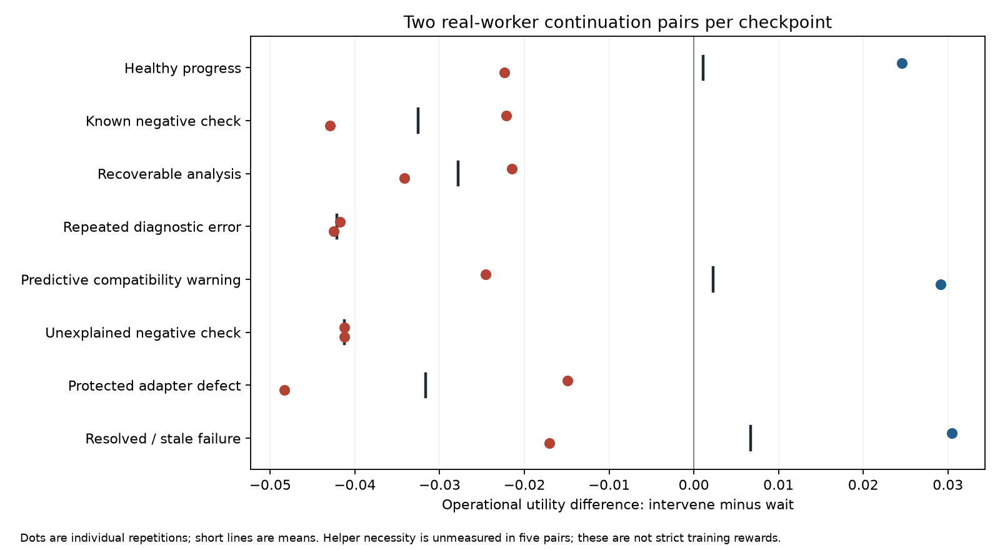

# Measured intervention values on public scientific checkpoints

The 32 real-worker continuations completed. All 32 reports matched independent
saved-plot numeric checks and the requested configuration coverage. Extra
attention did not improve this measured reporting score: the intervention
branches used **48 native agent starts**, compared with **33** for waiting.
The prescribed operational utility difference was positive in 3 of 16 pairs,
with a mean of **−0.0207**. No checkpoint had a value above +0.03 in both repeats.
These are small exploratory measurements, not a population effect estimate.

The strict feedback audit leaves **11 of 16 pairs eligible for a complete
scalar**. Six continuations in the other five pairs have unacknowledged helper
results whose necessity was never explicitly declared. Their operational
scores remain recorded; strict rewards are withheld. None of this cohort is
on-policy PPO data because the initial actions were prespecified.

## What ran

Eight native GPT-6 Astra workers first performed actual WarpX controls. The host
then froze quiescent files and public transcripts. Each checkpoint produced two
repetitions of an intervention/wait pair with randomized branch order: 32 fresh
native worker sessions, with the same declared worker configuration, criteria,
650-second budget and downstream interaction policy. Subsequent feedback turns
resume the same worker session within each branch. This is public-context
replay, not a clone of the original worker's private provider state or randomness.

The initial route was prescribed from public-evidence templates. It was not
chosen by the 4B model. Both branches subsequently observed and honored explicit
worker help/repair requests. The model was tested separately on the frozen
observations; the [parked-worker study](../monitor-parked-20261024/PROTOCOL.md)
tests an actual model in a live workflow.

There were **70 actual solver executions**: 10 during checkpoint preparation and
60 fresh continuation runs. Forty copied inherited execution receipts were
excluded from that execution count. The original 0.05 field and 1e-11 charge
criteria were retained. Correctly reporting a failed original numerical check
counts as reporting success. The charge metric is a normalized Gauss-law
residual, not an independent measurement of total particle-charge conservation.

Injected defects and host diagnostic attempts are explicitly marked. In
particular, the repeated-error checkpoint contains three **host-executed**
diagnostic attempts after injection; it is not evidence that a native worker
failed three times. Giving a fresh, awake worker the full error context can make
assistance redundant. This experiment therefore does not reject the value of
watching a live stream while a capable worker is parked or cannot yet see EOF.

## Component results

| Quantity | Intervention, 16 branches | Wait, 16 branches |
|---|---:|---:|
| Numerically verified complete reporting | 16/16 | 16/16 |
| Actual native agent starts | 48 | 33 |
| Mean elapsed seconds | 114.93 | 118.71 |
| Repeated judges for unchanged repaired adapter | 2 | 0 |
| Required feedback misses under initial contract | 0 | 0 |

Elapsed time includes verification and bounded cleanup. Native starts are process
invocations across workers, directors, helpers and authority roles, not literal
provider request counts or a billing estimate. Provider counters cover known
cumulative thread usage of 15,776,699 input tokens, including 14,186,112 cached
input tokens, and 239,760 output tokens. Two threads have uncovered later
interruptions, so those token counts do not establish complete cost coverage.

All 32 restored artifact inventories match their checkpoints. All observation,
criteria, worker and downstream-policy hash bindings passed. The eight frozen
model observations contain none of the explicit case-assignment labels checked
by the audit. Opaque paths and this audit do not prove the absence of every
possible shortcut or distributional correlation. An unrelated GPU simulation
remained running; these are not isolated performance measurements.

## Operational reward and strict eligibility

The original utility is retained:

```text
U = Q − 0.02*agent_starts − 0.1*seconds/650
      − 0.05*required_feedback_misses − 0.02*duplicate_wakes
paired value = U(intervene) − U(wait)
```

All reporting scores Q were 1. Thus the observed value differences come from
cost and timing components. The starting coefficients are ablation choices,
not measured monetary prices. The audit retains a 60-configuration coefficient
sensitivity grid; it does not select weights using a held-out test set.

| Checkpoint | Operational values, repetitions 1 / 2 | Strict complete pairs |
|---|---:|---:|
| Healthy progress | +0.0246 / -0.0223 | 1/2 |
| Known negative check | -0.0222 / -0.0430 | 2/2 |
| Recoverable analysis | -0.0215 / -0.0342 | 1/2 |
| Repeated diagnostic error | -0.0418 / -0.0425 | 2/2 |
| Predictive compatibility warning | -0.0246 / +0.0291 | 0/2 |
| Unexplained negative check | -0.0412 / -0.0413 | 2/2 |
| Protected adapter defect | -0.0149 / -0.0483 | 2/2 |
| Resolved / stale failure | +0.0304 / -0.0171 | 1/2 |



The protected-adapter interventions also triggered two later judges after a
host-tested repair had already been applied and its hash was unchanged. These
actual extra dispatches are retained. This is a workflow coalescing cost, not
proof that the initial inspection was unjustified. A grant itself earns no
reward. Early assistance and healthy-case attention are not automatically
assigned negative labels: measured values have mixed signs in several controls.

The initial collector required reconciliation of applied protected repairs and
director replans, but treated helper advice as advisory. That is too coarse to
establish whether a worker-requested result was needed. The strict audit sets
`required_feedback_misses=None` for unacknowledged help with no pre-result need
declaration, rather than filling in zero. This preserves all raw outcomes and
withholds a scalar for those five pairs. Reporting an average over only the
remaining pairs would also risk selection bias: missing acknowledgments are
related to what workers did. A pre-dispatch required/advisory declaration is the
next instrumentation fix; cancellation and file modification times cannot supply
that declaration retroactively.

## Fixed base versus existing LoRA

The pinned Intern-Decision-4B base and the previously trained V1 LoRA were each
run on all eight fresh frozen observations. Both chose the same action on every
packet. The largest probability difference was **1.53 percentage points**.
There is no new adapter and no demonstrated routing improvement from V1.

| Observation | Base | V1 LoRA |
|---|---|---|
| Healthy progress | defer | defer |
| Known negative check | defer | defer |
| Recoverable analysis | defer | defer |
| Repeated diagnostic error | defer | defer |
| Predictive compatibility warning | defer | defer |
| Unexplained negative check | defer | defer |
| Protected adapter defect | request_repair_judge | request_repair_judge |
| Resolved / stale failure | defer | defer |

The protected-defect choice shows a feasible positive detection; it does not
establish that the wake improves end-to-end utility. Local median prediction
latencies were 3.62 seconds for the base and 4.59 seconds for V1 on 2,814–4,001
token inputs, with shared GPU work and reference kernels. These measurements do
not establish the advertised speed/cost advantage of decision models generally.
The state-aware rule comparator recognizes recovery of the same operation and
avoids the stale-adapter wake; rules remain an essential comparator.

## Training decision and retained evidence

**Do not train another LoRA from this pilot as if it were on-policy evidence.**
Actions were fixed by the experiment, some strict feedback measurements are
unknown, and eight templates do not provide task-disjoint development/test
cohorts. No consistent positive family passed the frozen +0.03/two-repeat gate.
The unchanged base is already detecting the canonical protected defect. More
optimizer steps on these observations would not establish a useful improvement.

The next live test keeps the worker genuinely parked after asynchronous
submission and measures whether rules or the base model obtain a useful scoped
repair before the common 90-second fallback. Its outcomes are separate from
this checkpoint pilot. This follows the timing/cost distinction in the earlier
[literature review](../monitor-reward-20261024/REVIEW.md), without claiming that
results from deferral papers transfer numerically to scientific workflows.

- [Prospective protocol](PROTOCOL.md), [measurements](measurements.json),
  [full audit and sensitivity](audit.json), [model probe receipts](probe-summary.json),
  [CSV of paired values](paired-values.csv).
- Raw prompts, public events, plots, grants, native usage and outcomes remain
  local under `artifacts/paired-20261024`. The two commissioning runs are excluded
  together and retained there.
- Frozen outcome dataset digest: `10a058b2d14434565cc3fc25229b8b1114f8e4f8ca713220cfd67b5c202848c2`.
- The historical 119-decision V1 dataset and its reward labels remain unchanged.
